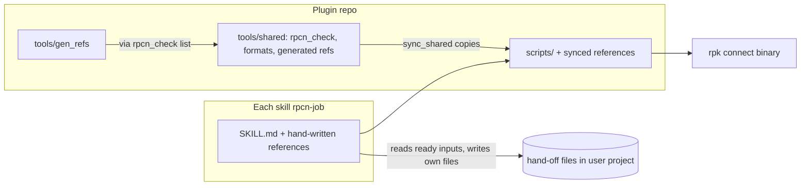
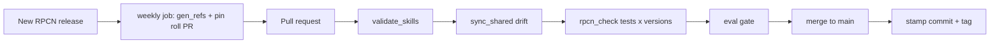

# Architecture Spine — RPCN Skills

## Design Paradigm

**Pipes and filters.** Each skill is a filter: it reads files from the developer's project, does one lifecycle job, and writes its own files. The files are the pipes. Skills never call each other or read each other's folders. All contact with Redpanda Connect goes through one adapter: the check script copied into each skill.

| Layer | Lives in | Role |
|---|---|---|
| Filters | `skills/rpcn-<job>/SKILL.md` + `references/` | One lifecycle job per skill |
| Adapter | `skills/rpcn-<job>/scripts/rpcn_check.py` | The only code that runs `rpk connect` |
| Shared sources | `tools/shared/` | Canonical check script, format docs and generated references, copied into skills |
| Pipes | the developer's project, beside the pipeline config | Hand-off files with versioned frontmatter |
| Build and verify | `tools/`, `evals/`, `.github/workflows/` | Sync, generate, validate, eval, release |



## Invariants & Rules

### AD-1 — One repo, two install channels, self-contained skills

- **Binds:** R13, all skills
- **Prevents:** a skill that works through the Claude Code plugin but not through `npx skills`, or the reverse
- **Rule:**
  - Every skill lives at `skills/rpcn-<job>/`.
  - The repo root holds `.claude-plugin/marketplace.json` (plugin `source: "./"`) and `.claude-plugin/plugin.json` (`"name": "rpcn-skills"`, `version`).
  - **Repo:** `github.com/ajurcenk/rpcn-skills`. Users install with `claude plugin marketplace add ajurcenk/rpcn-skills` or `npx skills add ajurcenk/rpcn-skills`. [ADOPTED]
  - A skill uses only files inside its own folder: no `../`, no repo-root paths, no reads from another skill. `npx skills` installs each skill folder alone and lets users pick a subset (verified, vercel-labs/skills 1.7.4).
  - **Only `rpcn-` skills are discoverable.** `npx skills` also scans `.claude/skills/` and `.agents/skills/`, so the BMad skills used to build this repo would be offered to users. Those folders are gitignored. `skills-lock.json` is committed, and contributors restore the BMad skills with `npx skills install`.

### AD-2 — Shared files: one source, copied, drift-checked

- **Binds:** R8, R11, R16, all skills
- **Prevents:** a skill breaking under a partial install, and copies of shared files drifting apart
- **Rule:**
  - **Sources:** every file used by more than one skill has one canonical source under `tools/shared/`:
    - `rpcn_check/`, the check script
    - `formats/<artifact>-format.md`, the hand-off formats with their readiness lists
    - `generated/`, the generated references
  - **Sync:** `tools/sync_shared.py` copies them byte-for-byte into each skill, as listed in that skill's `skills/rpcn-<job>/shared.txt`. CI fails if any copy differs from its source.
  - **Edits:** a skill never edits a copied file; changes go to the source.
  - **Binary calls:** no code, including `tools/gen_refs.py`, runs `rpk connect` except through `rpcn_check`. [ADOPTED]

### AD-3 — Script runtime: `uv` with PEP 723

- **Binds:** R8, every script in `tools/` and `skills/*/scripts/`
- **Prevents:** scripts that need different runtimes or undeclared packages
- **Rule:**
  - **Header:** every Python script starts with a PEP 723 header (`requires-python = ">=3.10"`, standard library first) and runs as `uv run <path>`.
  - **Banned:** never `python` or `pip`, and no `jq`.
  - **Compatibility field:** each skill sets `compatibility: "Requires rpk with Redpanda Connect >= 4.100.0, and uv."`
  - **Calling scripts:** SKILL.md calls `uv run ${CLAUDE_SKILL_DIR}/scripts/rpcn_check.py …`, with one line saying the path is relative to this SKILL.md's folder when the variable is not expanded. [ADOPTED]

### AD-4 — The check-script interface

- **Binds:** R2, R3, R5, R8, every skill
- **Prevents:** skills parsing `rpk connect` output in different ways, or calling it with different flags
- **Rule:**
  - **Subcommands:** `binary | lint | blobl | list | fields | run | test | hash`.
  - **Envelope:** each prints one JSON object:
    `{"schema": 1, "ok": bool, "command": str, "binary": {"path": str, "version": str}, "errors": [{"file": str, "line": int|null, "column": int|null, "message": str}], "data": object}`.
    The `data` shape for each subcommand is fixed in `tools/shared/rpcn_check/SCHEMA.md`, versioned by `schema`.
  - **`binary`** returns `data`:
    `{"plugin_version", "refs_version", "newer_than_refs": bool, "headless": bool}`.
    Every skill calls it first.
  - **`fields <kind> <component>`** returns the component's fields from the installed binary's `list --format jsonschema`. Author and Design use this, not the generated references, to check fields.
  - **`run`** is a bounded dry run with `--timeout` (default 10 s) and a file as input.
  - **`hash <files…>`** returns the sha256 of each file.
  - **Exit codes:** `0` when `ok`, `1` when a check failed, `2` for a usage or environment error (binary missing, below 4.100.0, bad arguments).
  - **Lint output:** lint has no JSON mode, verified on both pins, so `rpcn_check` parses its text output into `errors`.
  - **Arguments** are fixed:
    - lint: `lint --deprecated --skip-env-var-check`
    - run: `run --set http.enabled=false`
    - `--resources <file>` once per unique file, then `--env-file <file>`
    - blobl: `blobl [--env-file] --file <mapping>`
    - never `-v`, `--verbose`, `-` or `--chilled`
  - **Binary lookup:**
    1. `RPCN_BINARY` or `EVAL_RPCN_BINARY`
    2. `rpk` on PATH, run as `rpk connect`
    3. `redpanda-connect` on PATH

    The version comes from the `Version:` line, with a leading `v` stripped.
  - **Showing results:** a skill shows a result only after `ok: true`, or after reporting the remaining `errors`.

### AD-5 — Supported and tested binaries

- **Binds:** R8, R12, CI
- **Prevents:** a skill tested on one RPCN version behaving differently on another
- **Rule:**
  - **Floor:** 4.100.0 is the minimum.
  - **CI test versions:** CI tests every check against the floor and the newest RPCN release, which rolls forward through AD-14.
  - **Flavour:** the plain release build, not cgo, cloud or fips.
  - **Generated references** are built from the newest pin only.

### AD-6 — Hand-off files: one writer each

- **Binds:** R2–R7, R16, all skills
- **Prevents:**
  - a skill reading an unfinished or stale file
  - two skills writing the same file
  - names drifting between skills
- **Rule:**
  - **Files and writers:** files sit beside `<name>.yaml` in the developer's project. Exactly one skill writes each:

    | File | Only writer |
    |---|---|
    | `<name>.design.md` | rpcn-design (and Deviations entries from rpcn-author, AD-7) |
    | `<name>.yaml`, `<name>.resources.yaml`, `<name>.<label>.blobl`, `.env.example` | rpcn-author updates; rpcn-migrate only creates new ones |
    | `<name>_benthos_test.yaml` (`rpk connect test` cases) | rpcn-test (epic 2 confirms `rpk connect test` finds it by default) |
    | `<name>.samples.json` | rpcn-test (format in `formats/samples-format.md`) |
    | `<name>.test-report.md` | rpcn-test |
    | `<name>.capacity.md` | rpcn-scale |
    | `<name>.deploy/` with `deploy.md` | rpcn-deploy (deploy-only overrides stay here) |
    | `<name>.tune-report.md` | rpcn-tune |
    | `<name>.migration-report.md` | rpcn-migrate |

  - **Proposing changes:** Test, Tune and Deploy never edit the YAML. They put proposed diffs in their own report, and Author applies them.
  - **Frontmatter:** every Markdown hand-off file starts with:
    - `artifact: design|test-report|capacity|deploy|tune-report|migration-report`
    - `format: <artifact>@<major>`
    - `pipeline: <name>`
    - `status: draft|ready|superseded`
    - `produced_by: rpcn-<job>@<plugin version>`
    - `rpcn_version: <binary version>`
    - `inputs: [{file, sha256}]`
    - `updated: <ISO date>`
  - **Readiness:** a reader uses an input only when all of these hold:
    - its `status` is `ready`
    - its `format` major is one it knows
    - every `inputs` hash matches the current file (checked with `rpcn_check.py hash`)
    - its readiness list in `formats/<artifact>-format.md` passes

    Otherwise the reader treats the input as not ready.
  - **Pipeline YAML** has no frontmatter. It counts as ready when `<name>.test-report.md` is ready and that report's `inputs` hash matches the YAML.
  - **Entry points:** a missing design note never blocks these skills. Minimum inputs:
    - Scale: `<name>.yaml`, plus a workload description from the user
    - Deploy: `<name>.yaml` and `<name>.capacity.md`
    - Tune: `<name>.yaml` plus logs or metrics

### AD-7 — The design note is the contract between Design and Author

- **Binds:** R1, R15, R16; rpcn-design, rpcn-author, rpcn-test, rpcn-scale
- **Prevents:** a design and a pipeline that quietly diverge, and a Design re-run erasing Author's record
- **Rule:**
  - **Sections:** `<name>.design.md` has these, in order:
    1. Purpose
    2. Inputs
    3. Outputs
    4. Components
    5. Error handling (DLQ, retries, fallback)
    6. Delivery and ordering
    7. Idempotency
    8. Batching
    9. Throughput expectations
    10. Open decisions
    11. Deviations
  - **Components:** every component listed is checked with `rpcn_check.py fields`.
  - **Ready:** the note is `ready` when Open decisions holds nothing that blocks Author.
  - **Deviations:** entries are append-only rows (section, what, why, date, resolved).
    - Author may add rows and update `updated`, and nothing else.
    - When Design rewrites the note, it keeps every row, marking any it absorbed as `resolved`.
  - **Test** checks the pipeline against Error handling, Delivery and ordering, and Idempotency. It reports each mismatch as `mismatch`, or `deviation-recorded` when an unresolved row covers it.
  - **Scale** reads Throughput expectations when present.

### AD-8 — Headless status block

- **Binds:** R17, all skills
- **Prevents:** CI and evals each parsing a different ending, and skills deciding `blocked` by different rules
- **Rule:**
  - **When:** a skill runs headless when its prompt says it runs unattended, headless or non-interactively, or when `rpcn_check.py binary` reports `headless: true` (set by `RPCN_HEADLESS=1` or `EVAL_RPCN_HEADLESS=1`).
  - **Behaviour:** it never asks. Each gap becomes an entry in `open_questions`.
  - **`blocked`:** if and only if a required check fails, or a required input is missing or not ready (AD-6).
  - **`complete`:** otherwise, with any open questions listed.
  - **Ending:** exactly one fenced `json` block at the end:
    `{"status": "complete"|"blocked", "skill": "rpcn-<job>", "reason": str|null, "artifacts": [paths], "checks": {"lint": "pass"|"fail"|"skipped", "tests": "pass"|"fail"|"skipped"}, "open_questions": [str]}`

### AD-9 — Skill shape, descriptions and sibling edits

- **Binds:** R9, R12, R19, all skills
- **Prevents:** sibling skills stealing each other's triggers, and skills drifting in size or shape
- **Rule:**
  - **Description:** a short summary, then "Use when the user says …" with quoted phrases, then "Not for … — use rpcn-<sibling>" for each colliding sibling. At most 1024 characters.
  - **SKILL.md size:** around 800 tokens, and the validator warns above 1,200.
  - **References** are one level deep: `references/<topic>.md`, with generated ones flattened as `references/generated-<kind>.json`. Each is named only at the step that loads it.
  - **Last step:** SKILL.md ends with a "Next" step that names one sibling per situation.
  - **Sibling edits:** the epic that adds a skill also updates the existing siblings' "Not for" and "Next" lines and their eval negatives. That is the one allowed edit across epics.

### AD-10 — Naming and the clash list

- **Binds:** all skills, plugin, evals
- **Prevents:** collisions with `redpanda-data/connect` (`/rpcn:*`) and `redpanda-data/skills` (`/redpanda:*`), and case folders that can't be parsed
- **Rule:**
  - **Names:** skills are `rpcn-<job>` (design, author, test, tune, scale, deploy, migrate), and the plugin is `rpcn-skills`.
  - **Clash list:** `tools/clash-list.txt` lists every skill and command name in both coexisting sets. The validator fails on a name in it or in `retired.toml`.
  - **Eval case folders:** `evals/<skill>__<case>/`, with a double underscore between skill and case.

### AD-11 — References and failure modes

- **Binds:** R10, R11, R18, all skills
- **Prevents:** hand edits to generated content, and deprecated components lingering in skill text
- **Rule:**
  - **Generated:** `tools/gen_refs.py` writes `tools/shared/generated/` from `rpcn_check.py list` output for the newest pin, and AD-2 copies it. Nobody edits these files by hand.
  - **Hand-written:** each skill's own `references/*.md`.
  - **Failure modes:** `references/failure-modes.md`. The skill epic creates it. Its entries are added by the curated process from epic 4, one per case:
    - Symptom
    - Cause
    - Fix
    - Source (a GitHub issue URL)
    - Fixed in (an RPCN version, or "open")
  - **Deprecated scan:** the validator scans every SKILL.md, hand-written reference and eval prompt. It fails on component names that the generated references mark deprecated or removed, for example `kafka` and `kafka_franz`, replaced by `redpanda`.

### AD-12 — Versions and retired names

- **Binds:** R18
- **Prevents:** skills reporting different versions under a partial install, and a retired name coming back with a new meaning
- **Rule:**
  - **Source of truth:** the plugin version lives in `.claude-plugin/plugin.json`.
  - **Stamp:** a release commit stamps every SKILL.md with `metadata: { plugin-version: "<version>", rpcn-refs-version: "<newest pin>" }` and copies both into `rpcn_check`. The validator fails if a stamp differs from `plugin.json`.
  - **Newer binary:** a skill warns before using its references when `binary` reports `newer_than_refs`.
  - **Retired names:** `retired.toml` lists renamed and removed skills. A listed name is never reused.
  - **Release:** a git tag `v<version>` on the stamp commit on `main`. `npx skills` installs from `main`.

### AD-13 — Evals

- **Binds:** R8, R12, R15, R17
- **Prevents:** one skill measured by different rules than another, and an accuracy gate that the tool cannot actually enforce
- **Rule:**
  - **Trigger evals** stay in this repo. Cases use `claude plugin eval` (Claude Code ≥ 2.1.269): `evals/<skill>__<case>/` with `prompt.md`, `case.yaml` and `graders/`.
  - **Trigger cases** run with `--ablation none`, so `tool_used` graders count toward the score:
    - a positive case asserts `tool: Skill` with `input_match` on the skill name
    - a near-miss negative, for each sibling in the skill's "Not for" lines, uses `min: 0, max: 0`
    - `tools/eval_gate.py` computes suite accuracy from `aggregate-result.json`
  - **Task, hand-off and install checks** run in the separate test project `rpcn-test-skills` (sibling folder, not in this repo):
    - **Scenarios:** each lives in `scenarios/<skill>__<case>/` with `prompt.md`, an input `fixtures/` folder and `expect.toml` (the files that must exist, their `status`, and the AD-8 block that is expected).
    - **Runner:** `uv run run_scenarios.py` handles each scenario in turn:
      1. copies the scenario into a fresh temp folder
      2. installs `rpcn-skills` there the way a user would, from a local path in development or a git ref in CI
      3. runs Claude Code headless with the prompt
      4. runs the installed skill's `rpcn_check.py lint`/`blobl`/`hash` over the files left on disk
      5. parses the final AD-8 block
    - **Chains** (Design then Author then Test) run each step as a fresh headless session on the same folder. That proves R16.
    - **Coexistence:** coexistence scenarios also install the two coexisting skill sets, and assert which skill ran (or that none did), so R12's coexistence check runs here.
    - **Source code:** the test project never holds skill source. Installed skills there are gitignored.
    - `[ASSUMPTION: the install-from-ref command and the headless flags are verified in epic 1]`
  - **Repetition:** each trigger case and each scenario runs at least 3 times.
  - **Env vars:** native cases use only `EVAL_`-prefixed env vars.
  - **Gate:** trigger accuracy is at least 90%, out-of-scope negatives trigger no skill, and every scenario's produced files lint clean and match `expect.toml`.

### AD-14 — CI and release

- **Binds:** R11, R12, R18
- **Prevents:** a merge that skips a check, and a release without fresh references
- **Rule:**
  - **On every pull request:**
    - `validate_skills.py`, owned by epic 1; epic 4 adds its deprecated scan and version checks. It covers names, descriptions, size, file references, the clash list, retired names, stamps and the deprecated scan.
    - the `sync_shared` drift check
    - the `rpcn_check` unit tests on every AD-5 version
    - the trigger eval gate, and the `rpcn-test-skills` scenarios run against this commit
  - **CI environment:** rpk and uv are installed outside `$HOME` (the eval sandbox can't read `$HOME`), with each version via `rpk connect install --connect-version <v>`. Linux runners add bubblewrap and socat. CI is GitHub Actions on the repo. [ADOPTED] `[ASSUMPTION: the install command is verified in epic 1]`
  - **Weekly job:** it detects a new RPCN release, runs `gen_refs`, rolls the newest pin, and opens a PR within one week.
  - **Release** runs only from a green `main` (AD-12).



## Consistency Conventions

| Concern | Convention |
|---|---|
| Skill names | `rpcn-<job>`, matching the folder name. Lowercase, hyphens only. |
| Hand-off names | `<pipeline-name>.<artifact>.<ext>` beside `<pipeline-name>.yaml` (AD-6) |
| Script names | `snake_case.py`, with a test beside it at `tests/test_<name>.py` |
| Dates | ISO 8601 |
| Versions | RPCN versions without `v` in files. The plugin uses semver. |
| Secrets | Always `${ENV_VAR}`, with names listed in `.env.example`. Never inline values in any artifact. |
| Script errors | Shown through the AD-4 `errors` array, never as prose |
| Format changes | A breaking change bumps `<artifact>@<major>`, and readers reject unknown majors |

## Stack

| Name | Version |
|---|---|
| Redpanda Connect (floor / newest) | 4.100.0 / 4.115.0 (rolling) |
| uv | 0.13.5 |
| Python (`requires-python`) | >=3.10 |
| Claude Code (`claude plugin eval`) | >=2.1.269 |
| vercel-labs/skills (`npx skills`) | 1.7.4 |
| Agent Skills spec | agentskills.io, current |

## Structural Seed

```text
rpcn-skills/
  .claude-plugin/
    marketplace.json  plugin.json
  skills/rpcn-<job>/          # design author test tune scale deploy migrate
    SKILL.md  shared.txt
    references/               # hand-written + synced formats + generated-<kind>.json
    scripts/rpcn_check.py     # synced copy
  tools/
    shared/rpcn_check/  shared/formats/  shared/generated/
    sync_shared.py  gen_refs.py  validate_skills.py  eval_gate.py
    clash-list.txt
  evals/<skill>__<case>/
  retired.toml
  .github/workflows/
```

## Capability → Architecture Map

| Capability | Lives in | Governed by |
|---|---|---|
| R1, R15 Design | `skills/rpcn-design` | AD-6, AD-7, AD-9 |
| R2 Author | `skills/rpcn-author` | AD-4 (`fields`), AD-6, AD-7 |
| R3 Test | `skills/rpcn-test` | AD-4 (`lint`, `blobl`, `run`, `test`), AD-6, AD-7 |
| R4 Tune | `skills/rpcn-tune` | AD-6 (diffs, entry point) |
| R5 Scale | `skills/rpcn-scale` | AD-6, AD-7 |
| R6 Deploy | `skills/rpcn-deploy` | AD-6, conventions (secrets) |
| R7 Migrate | `skills/rpcn-migrate` | AD-4, AD-6, AD-8 |
| R8 Binary checks | `tools/shared/rpcn_check` | AD-2, AD-3, AD-4, AD-5 |
| R9, R19 Shape, Next | every SKILL.md | AD-9 |
| R10 Failure modes | `references/failure-modes.md` | AD-11 |
| R11 Release sync | `gen_refs`, weekly job, validator | AD-11, AD-14 |
| R12 Evals | `evals/` (triggers), `rpcn-test-skills` (scenarios) | AD-13 |
| R13 Install | `.claude-plugin/`, `skills/` | AD-1 |
| R16 Hand-offs | user project | AD-6, AD-7 |
| R17 Headless | every SKILL.md, `binary`, scenario runner | AD-8, AD-13 |
| R18 Versioning | `plugin.json`, stamps, `retired.toml` | AD-10, AD-12 |

## Deferred

- **Load-test environment** for the ±20% checks (R4–R6): epic 5 decides it, and it must be reproducible and recorded in `<name>.capacity.md`. Epic 6 reuses it.
- **Org-facts file:** an initiative open question. It would be a new optional input under AD-6.
- **Capacity model for Scale:** epic 5.
- **Deployment specifics** (Helm chart source, BYOC API or CLI, layout inside `<name>.deploy/`): epic 5, within AD-6.
- **Migrate mapping tables:** epic 7, producing AD-6 files and the AD-8 status.
- **VS Code extension integration:** out of scope (initiative decision 2026-10-23).
- **Failure-mode sources beyond GitHub:** later, using the AD-11 entry shape.
- **When evals and scenarios run in CI** (every PR, path filters, nightly, forks and API-key secrets): epic 1 decides, within R12's rule that every change affecting a skill runs them.
- **How `rpcn-skills` CI gets `rpcn-test-skills`** (a sibling GitHub repo checked out at `main`, or a pinned ref): epic 1 decides once that project has a remote.
- **Windows:** out of scope. Skills, scripts and CI target Linux and macOS only.
- **Telemetry:** out of scope.
